# 🛡️ Oblivion Vault

> **Decentralized, Zero-Cloud-Storage, Peer-to-Peer (P2P) Encrypted Messenger & Direct Vault**  
> Built with **Android**, **Kotlin**, **Jetpack Compose**, and **WebRTC DataChannels** with ephemeral **Firebase** signaling.

[-3DDC84?logo=android&logoColor=white)](#prerequisites--tech-stack)
[](#prerequisites--tech-stack)
[-4285F4?logo=jetpackcompose&logoColor=white)](#prerequisites--tech-stack)
[](#architecture--workflow)
[-brightgreen)](#security--privacy-blueprint)

---

## 📌 Overview

**Oblivion Vault** is a secure, privacy-first mobile messaging and direct file-transfer platform. Unlike conventional cloud messengers (WhatsApp, Telegram, Slack) that store your messages, media, and logs on centralized corporate databases, Oblivion Vault operates on a **Zero-Cloud-Storage architecture**:

* **No server-stored messages or media**: Text and files are streamed directly **device-to-device** over encrypted WebRTC SCTP DataChannels.
* **Ephemeral matchmaking**: Firebase Realtime Database is utilized *strictly* as a short-lived signaling relay to exchange SDP handshakes and ICE candidates.
* **Zero data retention**: Signaling records are deleted immediately upon consumption, and room nodes are wiped from existence upon session termination.
* **Hardware-enforced privacy**: Native `FLAG_SECURE` protections prevent screenshots, screen recording, and multitasking switcher previews.

---

## ✨ Key Features

| Feature | Description |
| :--- | :--- |
| **🔒 Direct P2P Encryption** | All payload transfers run directly over WebRTC DataChannels secured by DTLS-SRTP encryption without intermediate media servers. |
| **🔑 Ephemeral Room & OTP Auth** | Ad-hoc session pairing using a 6-character Room ID and a 6-digit session OTP. Handshakes are strictly gated until OTP verification passes. |
| **⚡ 64 KB Chunk Streaming** | High-throughput direct-to-disk streaming via `RandomAccessFile` with backpressure control (`bufferedAmount`) to handle multi-gigabyte transfers with minimal RAM consumption. |
| **🛡️ Anti-Screen Capture** | Hardware-level `FLAG_SECURE` integration blocks screenshot key-combos, disables recording tools, and hides chat previews in Android's recent apps switcher. |
| **📶 Network Jitter Resilience** | Intelligent 6-second recovery grace period for transient ICE disconnections, preventing dropped sessions during Wi-Fi to mobile data handovers. |
| **🎨 Modern Jetpack Compose UI** | Dark theme, responsive two-pane layout support (wide screens/foldables/tablets), and isolated composer components for lag-free typing. |
| **🧹 Auto-Purge Lifecycle** | Real-time signaling queues auto-delete consumed packets and destroy room records the moment either peer disconnects. |

---

## 🏗️ Architecture & Workflow

Oblivion Vault decouples **signaling** from **data transmission**:
1. **Signaling Plane (Firebase)**: Exchanges public network coordinates (STUN ICE Candidates) and connection parameters (SDP Offer/Answer).
2. **Data Plane (WebRTC SCTP)**: Operates directly peer-to-peer once the channel opens.

```mermaid
sequenceDiagram
    autonumber
    actor Host as 📱 Host (Peer A)
    participant Signaling as 🔥 Firebase RTDB (Signaling)
    actor Guest as 📱 Guest (Peer B)

    Note over Host: Taps "Create Session"
    Host->>Host: Generates 6-char RoomID & 6-digit OTP
    Host->>Signaling: Creates /rooms/{RoomId} (status: WAITING)
    Host-->>Guest: Shares Room ID & OTP (out-of-band)

    Note over Guest: Inputs Room ID + OTP
    Guest->>Signaling: Validates OTP & updates status: CONNECTING
    Signaling-->>Host: Room update (Guest joined)

    Note over Host: Initializes WebRTC PeerConnection
    Host->>Host: Creates DataChannel ("p2p-datachannel") & SDP Offer
    Host->>Signaling: Pushes SDP Offer to /rooms/{RoomId}/signals/{GuestId}
    Signaling-->>Guest: Receives SDP Offer (auto-deleted from Firebase)

    Guest->>Guest: Sets Remote Description & Generates SDP Answer
    Guest->>Signaling: Pushes SDP Answer to /rooms/{RoomId}/signals/{HostId}
    Signaling-->>Host: Receives SDP Answer

    par ICE Candidate Exchange
        Host->>Signaling: Exchanges STUN ICE Candidates
        Guest->>Signaling: Exchanges STUN ICE Candidates
    end

    Note over Host,Guest: Direct P2P SCTP DataChannel Established (State: OPEN)
    Host->>Signaling: Updates Room status: CONNECTED

    rect rgb(20, 35, 20)
        Note over Host,Guest: 🔒 Zero-Knowledge P2P Channel (No Server Involvement)
        Host->>Guest: Direct UTF-8 Text Messages
        Host->>Guest: 64KB Binary File Chunks + Flow Control
    end

    Note over Host: Taps "Terminate Session"
    Host->>Signaling: Deletes /rooms/{RoomId}
    Host->>Host: Closes DataChannel & PeerConnection
```



---

## 📂 Project Structure

```text
Oblivion Vault/
├── Oblivioun vault/
│   ├── app/
│   │   ├── src/main/
│   │   │   ├── AndroidManifest.xml          # App permissions, providers & FLAG_SECURE config
│   │   │   ├── java/com/codewithkael/androidminichatwithwebrtc/
│   │   │   │   ├── di/
│   │   │   │   │   └── AppModule.kt         # Hilt DI bindings (Firebase, WebRTCFactory, Gson)
│   │   │   │   ├── remote/
│   │   │   │   │   ├── FirebaseClient.kt    # Ephemeral signaling, OTP validation, auto-cleanup
│   │   │   │   │   ├── RoomModels.kt        # Room data structures and status enumerations
│   │   │   │   │   └── StatusDataModel.kt   # Status payload mappings
│   │   │   │   ├── ui/
│   │   │   │   │   ├── MainActivity.kt      # Window setup, edge-to-edge drawing, FLAG_SECURE
│   │   │   │   │   ├── components/
│   │   │   │   │   │   └── ChatSection.kt   # Message list, attachment card, progress bars
│   │   │   │   │   ├── screens/
│   │   │   │   │   │   └── MainScreen.kt    # Responsive two-pane UI, isolated message composer
│   │   │   │   │   ├── theme/               # Color palette, Typography, Dark Theme
│   │   │   │   │   └── viewmodels/
│   │   │   │   │       └── MainViewModel.kt # State management, ICE recovery, coroutine dispatch
│   │   │   │   ├── utils/
│   │   │   │   │   ├── ChatItem.kt          # Chat message and file transfer model
│   │   │   │   │   ├── ConnectionState.kt   # Sealed class for UI state transitions
│   │   │   │   │   └── MediaStoreHelper.kt  # MediaStore download integration
│   │   │   │   └── webrtc/
│   │   │   │       ├── RTCClient.kt         # WebRTC client interface
│   │   │   │       ├── RTCClientImpl.kt     # SCTP DataChannel streaming, 64KB chunking, flow control
│   │   │   │       └── WebRTCFactory.kt     # PeerConnectionFactory & STUN server setup
│   │   │   └── res/                         # Vector assets, themes, mipmap icons
│   │   └── build.gradle.kts                 # Dependencies and Android configuration
│   ├── build.gradle.kts                     # Root build configuration
│   ├── gradle.properties                    # JVM memory & AndroidX flags
│   └── settings.gradle.kts                  # Plugin and dependency management
```

---

## 🛠️ Prerequisites & Tech Stack

### Core Dependencies
* **Language & Runtimes**: Kotlin `1.9.23`, Java `17`
* **Android SDK**: `compileSdk = 35`, `minSdk = 24` (Android 7.0+), `targetSdk = 34`
* **UI & Architecture**:
  * Jetpack Compose (BOM `2024.09.00`) & Material 3
  * ViewModel & StateFlow / Coroutines
  * Dagger Hilt `2.51.1` (Dependency Injection)
* **Networking & WebRTC**:
  * `google-webrtc` (SCTP DataChannels & PeerConnections)
  * Firebase Realtime Database KTX (Signaling)
  * STUN servers (`stun.l.google.com:19302`, `stun.relay.metered.ca:80`)
* **Serialization & Storage**:
  * Google Gson
  * Java NIO / `RandomAccessFile` direct-to-disk chunk assembly

---

## 🚀 Setup & Installation

### 1. Clone the Repository
```bash
git clone https://github.com/your-username/Oblivion-Vault.git
cd "Oblivion-Vault/Oblivioun vault"
```

### 2. Configure Android SDK
Ensure you have a `local.properties` file in the root of the project pointing to your Android SDK:
```properties
sdk.dir=C\:\\Users\\<YourUsername>\\AppData\\Local\\Android\\Sdk
```
*(On Linux/macOS: `sdk.dir=/Users/<username>/Library/Android/sdk`)*

### 3. Firebase Configuration
1. Create a Firebase project at the [Firebase Console](https://console.firebase.google.com/).
2. Enable **Firebase Realtime Database**.
3. Download `google-services.json` and place it into `app/google-services.json`.
4. Ensure your Realtime Database security rules permit read/write access for authenticated or ephemeral rooms:
   ```json
   {
     "rules": {
       "rooms": {
         ".read": true,
         ".write": true
       }
     }
   }
   ```

### 4. Build and Install via Gradle / ADB
```bash
# Compile debug APK
./gradlew assembleDebug

# Install on connected device or emulator
adb install -r app/build/outputs/apk/debug/app-debug.apk
```

---

## 🔒 Security & Privacy Blueprint

1. **Hardware-Enforced Screen Protection (`FLAG_SECURE`)**:
   Enforced in `MainActivity.kt`, preventing the window from being captured in screenshots, video recordings, or task-switching previews.
2. **Ephemeral Signal Consumption**:
   Signaling data is purged immediately after ingestion (`snapshot.ref.removeValue()`), leaving no digital trace in the database.
3. **DTLS-SRTP Wire Encryption**:
   Direct DataChannels are encrypted by standard WebRTC cryptographic handshakes, ensuring Wi-Fi or cellular operators cannot decrypt raw payloads.
4. **Memory-First Footprint**:
   Neither chats nor decrypted credentials are written to persistent device databases (SQLite/Room). Exiting the room clears in-memory state.

---

## 📄 License

This project is open-source and available under the [MIT License](LICENSE).
